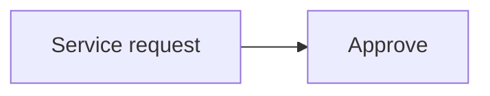

# DocForge Author Quick Start

## Prerequisites

- Visual Studio Code
- GitHub Copilot enabled for VS Code
- Node.js 24 LTS
- The DocForge repository opened as the VS Code workspace

## Starting a New Publication

1. Open the `DocForge` folder in VS Code.
2. Open Copilot Chat in the workspace.
3. Type `/` in Copilot Chat and select `start-project` (listed as a skill).
4. Tell Copilot:
   - the short project name;
   - the channel: `report`, `sales`, or `offer`;
   - the source file or folder;
   - the audience;
   - the language or languages;
   - required customer branding;
   - required Word/PDF outputs.

Copilot will scaffold `projects/<project-name>/`, preserve source material, prepare the manifest, and convert the publication content into authored Markdown.

## Review Points

Before the first build, confirm:

- the source file is complete and approved for use;
- the project title is correct;
- the channel is correct;
- the language is correct;
- no confidential or unsupported claims are being added;
- customer branding is approved;
- prices and contractual terms are verified for offer projects.

## Build and Review

From the repository root:

```powershell
npm.cmd run build -- <project-name>
npm.cmd test
```

Open `projects/<project-name>/output/<project-name>.html` and review desktop, mobile, navigation, search, links, print/PDF, and Word export as applicable.

Do not edit generated output files. Return to the project Markdown or manifest and rebuild.

## Hero Authoring

Place hero content between `<!-- hero:start -->` and `<!-- hero:end -->`. Use an H3 for the headline, a bold introductory line for the audience or topic, a short supporting paragraph, an optional list for decision-relevant evidence, and an optional link as the next action.

Add an author-supplied image as an ordinary Markdown image inside the hero:

```markdown
<!-- hero:start -->

**Customer context or assessment type**

### Main decision-oriented headline

Supporting explanation grounded in approved material.


- Approved evidence point
- Supported implication

[Continue to the assessment](#assessment-0)

<!-- hero:end -->
```

Image paths are project-relative and embedded in the standalone offline output. Remote URLs are rejected. Use empty alt text for a decorative image. Copilot can help select, prepare, or generate an appropriate image when requested, but the author must verify subject accuracy, brand suitability, accessibility, and permission to use or publish it.

## Chart Authoring

Place a supported chart marker immediately before its Markdown source table. Keep the table as the accessible and reviewable data source; ECharts renders the visual beside it at runtime.

```markdown
<!-- chart:line -->

| Quarter | Actual | Plan |
| --- | ---: | ---: |
| Q1 | 42 | 48 |
| Q2 | 55 | 57 |
```

Supported markers are `bar`, `line`, `area`, `stacked-bar`, `radar`, `donut`, `scatter`, `heatmap`, and `funnel`. Use additional numeric columns for multiple series. Scatter uses two numeric columns, radar uses categories as rows and series as columns, and heatmap uses all numeric columns as a matrix.

The publication toolbar offers `Fujitsu`, `Color-safe`, and `Ocean` visual palettes. `Fujitsu` is the default and uses the red-led brand family with supporting teal, gold, gray, and violet. Palette changes update charts and Mermaid diagrams and are stored in the viewer's browser. Chart motion is disabled when the operating system requests reduced motion.

## Diagram Authoring

Use fenced `mermaid` blocks for editable flows, architecture relationships, swimlanes, sequences, and roadmaps. DocForge renders them to SVG and uses the shared visual palette.

````markdown

````

Use `flowchart LR` for horizontal processes, `flowchart TB` for vertical methods, `sequenceDiagram` for swimlanes and handoffs, and `gantt` for delivery schedules. Keep labels short enough to remain readable at compact widths.

Use `<!-- visual:architecture -->` immediately before a table with `Layer`, `Description`, `Placement`, and `Context` columns. Set `Placement` to `Stack` or `Side` to create layered service, platform, infrastructure, security, or network views.

Use `<!-- visual:sales-roadmap -->` immediately before a table with `Phase`, `Objective`, `Activities`, `Outcome`, and `Timing` columns. This creates a customer-facing roadmap centered on business priorities, decisions, proof points, and outcomes rather than task scheduling alone.

## Everyday Copilot Prompts

- `Review the source outline and propose the project structure.`
- `Convert the supplied Word document without changing approved wording.`
- `Add this section using the selected publication channel.`
- `Explain the factual ambiguities before making presentation changes.`
- `Build the project and check desktop and mobile output.`

## Human Approval

Automated conversion and testing do not verify factual accuracy, accessibility compliance, customer approval, contractual validity, or permission to publish. The author remains responsible for those checks.
