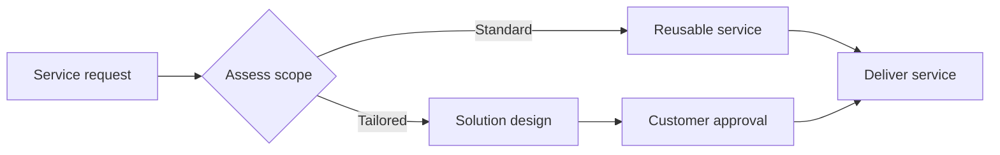
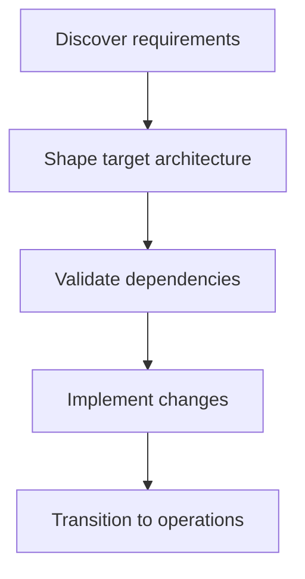
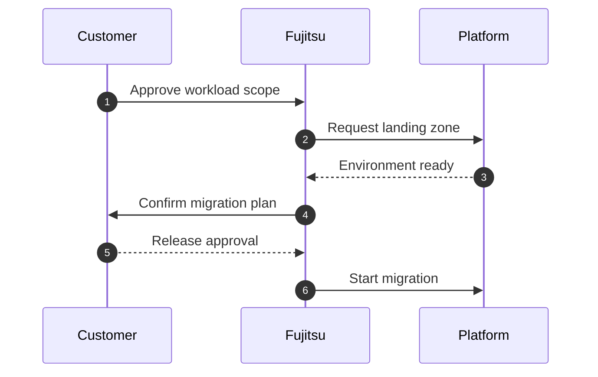

# DocForge Starter Publication

## Introduction

Lorem ipsum dolor sit amet, consectetur adipiscing elit. This starter publication exercises the canonical DocForge report layout without using production customer content.

### Decision

Lorem ipsum dolor sit amet, consectetur adipiscing elit. Integer non sem vitae metus commodo facilisis.

### Decision model

Lorem ipsum dolor sit amet, consectetur adipiscing elit. Donec malesuada erat quis lectus porta, vitae vestibulum lorem aliquet.

### Outcome

Lorem ipsum dolor sit amet, consectetur adipiscing elit. Curabitur vitae nulla at arcu sollicitudin ullamcorper.

### Details

| Area | Placeholder |
| --- | --- |
| Scope | Lorem ipsum dolor sit amet. |
| Deliverables | Consectetur adipiscing elit. |
| Next step | Integer non sem vitae metus commodo facilisis. |

## Components

<!-- cards:start -->

<!-- card:start -->

### First component

Lorem ipsum dolor sit amet, consectetur adipiscing elit.

<!-- card:end -->

<!-- card:start -->

### Second component

Lorem ipsum dolor sit amet, consectetur adipiscing elit.

<!-- card:end -->

<!-- cards:end -->

<!-- callout:info:start -->

### Important information

This content is placeholder text for layout and behavior validation.

<!-- callout:end -->

## Navigation and search

The starter confirms heading structure, Level 1 section navigation, Heading 2 dropdown behavior, page-specific tabs, search, responsive wrapping, and offline output.

### Page hierarchy

Use H1 for a top-level navigation group, H2 for a page in that group, and H3 for related topics inside the current page.

### Page tabs

Add an H2 page ID to `navigation.tabSections` when its H3 topics should become in-page tabs. This page demonstrates that behavior directly.

### Search behavior

Search indexes publication headings and text across all H2 pages. Selecting a result opens the matching page while preserving the same offline publication.

# Component showcase

## Hero and message

<!-- hero:start -->

**Infrastructure current state assessment**

### Know what needs attention before the next infrastructure investment

Decide what to retain, modernize, or protect by connecting the current-state evidence to business priorities, risks, and practical next steps.


- Current-state evidence across critical domains
- Priorities linked to operational risk and business impact
- A clear path from assessment to action

[Explore the component gallery](#starter-8)

<!-- hero:end -->

## Data visuals

<!-- chart:bar -->

| Area | Value |
| --- | ---: |
| North | 42 |
| West | 68 |
| Central | 53 |
| South | 77 |

The table remains available as the accessible data source for the generated visual.

## Content patterns

### Structured list

- First approved point
- Second approved point
- Third approved point

### Ordered process

1. Understand the supplied material.
2. Structure the approved content.
3. Publish and review the result.

<!-- cards:start -->

<!-- card:start -->

### Compact card

Lorem ipsum dolor sit amet, consectetur adipiscing elit.

<!-- card:end -->

<!-- card:start -->

### Detailed card

Lorem ipsum dolor sit amet, consectetur adipiscing elit. Integer non sem vitae metus commodo facilisis.

<!-- card:end -->

<!-- cards:end -->

### Code

Use `platform.environment` to identify the target environment in configuration and operational guidance.

```yaml
platform:
  name: OpenShift
  environment: production
  controls:
    - name: identity
      owner: security
    - name: monitoring
      owner: operations
```

### Table

| Role | Operational responsibility | Decision gate |
| --- | --- | --- |
| FSS / OpenShift team | Platform operation, cluster health, runtime incidents | Service readiness accepted |
| Fujitsu DBA | Database availability, data protection, recovery | Recovery evidence approved |
| Requesting team | Application behavior, support ownership, release approval | Production change authorized |

<!-- callout:success:start -->

### Callout

The publication structure, hierarchy, and data presentation are ready for validation.

<!-- callout:end -->

## Visual gallery

Use this page to compare ECharts visual families available to DocForge authors. Every example is generated from the adjacent Markdown table.

<!-- charts:start -->

<!-- chart-card:start -->

### Bar comparison

<!-- chart:bar -->

| Area | Readiness |
| --- | ---: |
| North | 72 |
| West | 58 |
| Central | 84 |
| South | 67 |

<!-- chart-card:end -->

<!-- chart-card:start -->

### Line trend

<!-- chart:line -->

| Quarter | Actual | Plan |
| --- | ---: | ---: |
| Q1 | 42 | 48 |
| Q2 | 55 | 57 |
| Q3 | 63 | 65 |
| Q4 | 76 | 74 |

<!-- chart-card:end -->

<!-- chart-card:start -->

### Area trend

<!-- chart:area -->

| Month | Foundation | Adoption |
| --- | ---: | ---: |
| Jan | 18 | 8 |
| Feb | 31 | 15 |
| Mar | 43 | 27 |
| Apr | 52 | 40 |

<!-- chart-card:end -->

<!-- chart-card:start -->

### Stacked composition

<!-- chart:stacked-bar -->

| Region | Legacy | Modernizing | Modern |
| --- | ---: | ---: | ---: |
| North | 22 | 38 | 40 |
| West | 35 | 31 | 34 |
| Central | 14 | 42 | 44 |

<!-- chart-card:end -->

<!-- chart-card:start -->

### Radar profile

<!-- chart:radar -->

| Dimension | Current | Target |
| --- | ---: | ---: |
| Governance | 7 | 9 |
| Automation | 5 | 8 |
| Security | 8 | 9 |
| Resilience | 6 | 9 |
| Cost control | 7 | 8 |

<!-- chart-card:end -->

<!-- chart-card:start -->

### Donut share

<!-- chart:donut -->

| Workload | Share |
| --- | ---: |
| Retain | 34 |
| Modernize | 29 |
| Migrate | 24 |
| Retire | 13 |

<!-- chart-card:end -->

<!-- chart-card:start -->

### Scatter relationship

<!-- chart:scatter -->

| Initiative | Effort | Impact |
| --- | ---: | ---: |
| A | 2 | 7 |
| B | 4 | 6 |
| C | 5 | 9 |
| D | 7 | 5 |
| E | 8 | 8 |

<!-- chart-card:end -->

<!-- chart-card:start -->

### Heatmap intensity

<!-- chart:heatmap -->

| Service | Week 1 | Week 2 | Week 3 | Week 4 |
| --- | ---: | ---: | ---: | ---: |
| Compute | 4 | 7 | 6 | 9 |
| Network | 6 | 5 | 8 | 7 |
| Data | 3 | 6 | 9 | 8 |

<!-- chart-card:end -->

<!-- chart-card:start -->

### Funnel progression

<!-- chart:funnel -->

| Stage | Opportunities |
| --- | ---: |
| Identified | 100 |
| Assessed | 74 |
| Qualified | 52 |
| Committed | 31 |

<!-- chart-card:end -->

<!-- charts:end -->

## Diagram gallery

Use these editable Mermaid patterns for consistent process, architecture, and roadmap visuals. The diagram source remains part of the publication Markdown and is rendered as SVG at runtime.

<!-- diagrams:start -->

<!-- diagram-card:start -->

### Horizontal flow



Left-to-right flows work well for short decision and delivery processes.

<!-- diagram-card:end -->

<!-- diagram-card:start -->

### Vertical flow



Top-to-bottom flows suit staged methods, controls, and operating models.

<!-- diagram-card:end -->

<!-- diagram-card:start -->

### Swimlane handoffs



Swimlanes make ownership and handoffs explicit without relying on decoration.

<!-- diagram-card:end -->

<!-- diagram-card:start -->

### Layered solution architecture

<!-- visual:architecture -->

| Layer | Description | Placement | Context |
| --- | --- | --- | --- |
| Cluster and application services | Ingress, routing, application and data services | Stack | Reusable application platform |
| Automated operations | Azure DevOps pipelines, GitOps and operational telemetry | Stack | OpenShift Operators and automation |
| Enterprise Linux platform | Red Hat OpenShift Container Platform | Stack | Consistent application runtime |
| Private cloud and storage | Compute, resilient storage and platform networking | Stack | Integrated infrastructure foundation |
| Access and network | Active Directory, DNS, load balancing, firewalls and hybrid connectivity | Side | Governance and secure access |

Architecture stacks communicate ownership, layers, dependencies, and platform boundaries from a structured table.

<!-- diagram-card:end -->

<!-- diagram-card:start -->

### Sales transformation roadmap

<!-- visual:sales-roadmap -->

| Phase | Objective | Activities | Outcome | Timing |
| --- | --- | --- | --- | --- |
| Create the case | Align investment to a customer priority | Validate estate, quantify constraints, agree measurable outcomes | Approved business case | Weeks 1-4 |
| Establish the path | Turn the ambition into an executable plan | Shape target state, identify dependencies, select a pilot | Funded implementation plan | Weeks 4-8 |
| Prove the value | Demonstrate outcomes with a controlled first release | Deliver pilot, measure adoption, resolve operational risk | Evidence-backed decision | Months 2-4 |
| Scale with confidence | Expand proven capabilities across the estate | Industrialize migration, enable teams, track business outcomes | Repeatable transformation engine | Months 4-12 |

This customer-facing roadmap makes the value proposition, decision gates, proof points, and outcomes visible before detailed delivery dates.

<!-- diagram-card:end -->

<!-- diagrams:end -->

## Choose a component

Start with the communication need, then select the smallest component that makes the approved content easier to scan, compare, or explain.

<!-- cards:start -->

<!-- card:start -->

### [Hero](#starter-3-know-what-needs-attention-before-the-next-infrastructure-investment)

Use an image-led hero for the publication's primary message, audience context, supporting evidence, and next action.

<!-- card:end -->

<!-- card:start -->

### [Content patterns](#starter-5-code)

Use lists, cards, callouts, code, and tables for authored explanations, responsibilities, controls, and structured reference material.

<!-- card:end -->

<!-- card:start -->

### [Data chart](#starter-6-bar-comparison)

Use bar, line, area, stacked, donut, scatter, heatmap, radar, or funnel charts when the comparison or trend is established by numeric data.

<!-- card:end -->

<!-- card:start -->

### [Process flow](#starter-7-horizontal-flow)

Use horizontal or vertical Mermaid flows when the sequence, branching decision, or handoff is the main message.

<!-- card:end -->

<!-- card:start -->

### [Swimlane](#starter-7-swimlane-handoffs)

Use a swimlane sequence when ownership and exchanges between customer, service team, and platform are essential to the explanation.

<!-- card:end -->

<!-- card:start -->

### [Architecture](#starter-7-layered-solution-architecture)

Use the layered architecture visual for platforms, service boundaries, dependencies, infrastructure, security, or network context.

<!-- card:end -->

<!-- card:start -->

### [Sales roadmap](#starter-7-sales-transformation-roadmap)

Use the sales roadmap to show business objectives, customer decisions, proof points, outcomes, and indicative timing in one narrative.

<!-- card:end -->

<!-- cards:end -->
